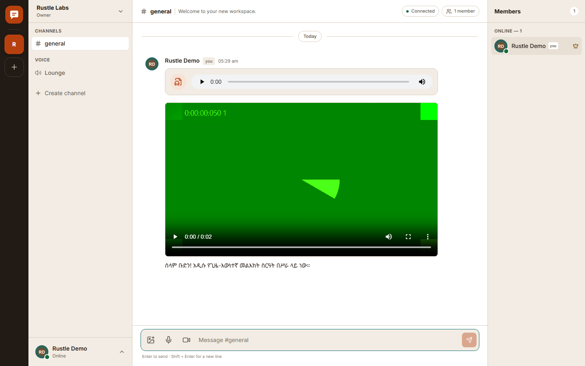
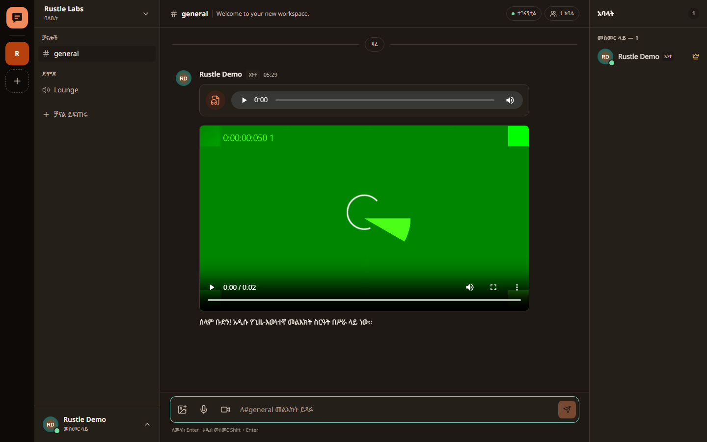
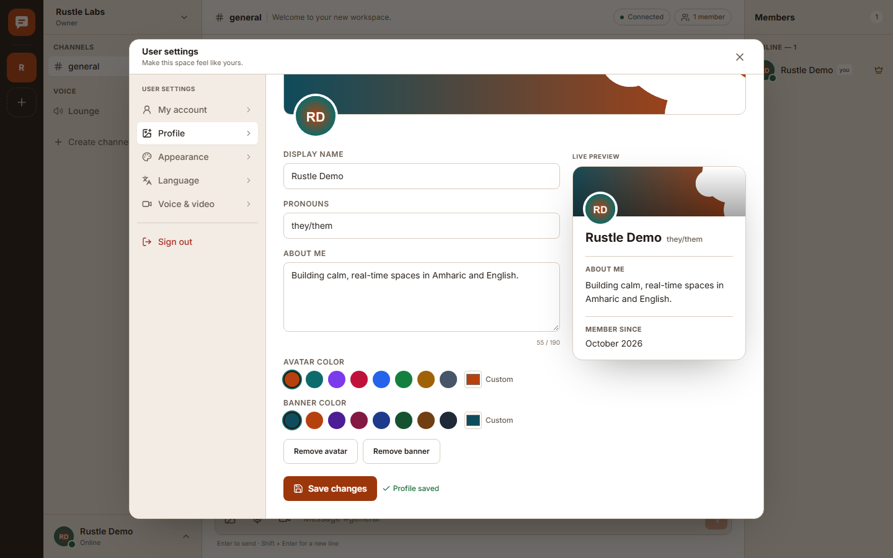
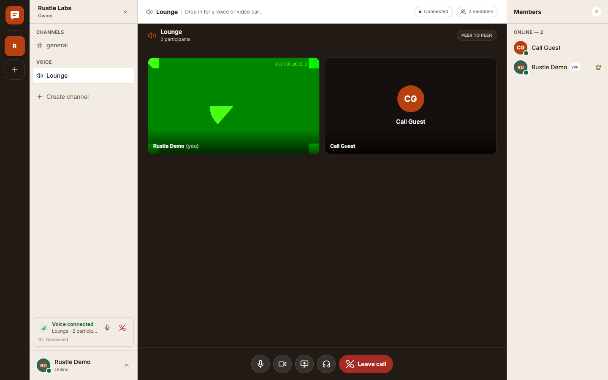
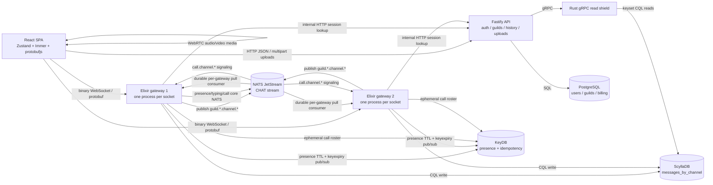

# Rustle

A production-shaped real-time chat workspace with an Elixir/BEAM WebSocket gateway, NATS JetStream fan-out, ScyllaDB message storage, KeyDB presence, a Rust gRPC read shield, PostgreSQL metadata, and a React + Zustand SPA with binary protobuf frames, editable Discord-style profiles, peer-to-peer WebRTC voice/video calls, and recorded voice/video messages.

The UI is fully available in **English** and **አማርኛ (Amharic)**, with bundled Ethiopic fonts, light/dark/system themes, and WCAG AA contrast checked by automated tests.

> **Validation note:** this workspace ran the gateway ExUnit suite (18 tests), Rust shield suite (6 tests), API tests (12), frontend unit tests (20), production builds, every application Docker image, and a full Docker Compose stack. A cross-node end-to-end run passed through **PostgreSQL → API → two Elixir gateways → ScyllaDB → NATS JetStream → Rust read shield → API history → KeyDB presence expiry/DND/offline**, plus cross-gateway call roster and targeted offer/answer signaling. A real Chrome smoke test authenticated, uploaded an avatar and banner, edited a profile, joined a WebRTC video call, recorded and sent a voice message and a video message, reconciled a text message, opened a member profile, and checked Amharic + dark mode with Ethiopic fonts/LTR. A second real-Chrome test connected two peers in one WebRTC call and verified remote audio/video tracks.

 

 

## Architecture at a glance



Read [docs/ARCHITECTURE.md](docs/ARCHITECTURE.md) for the write/read/presence paths, failure behavior, and scaling notes.

## What is included

| Area | Implementation |
| --- | --- |
| Gateway | Elixir 1.18 / OTP 27, Cowboy WebSocket, one process per connection, protobuf binary frames, auth, rate limiting, size limits, slow-consumer isolation. |
| Broker | NATS JetStream stream `CHAT` over `guild.<guild_id>.channel.<channel_id>`, one durable pull consumer per gateway, wildcard routing, server-bounded `max_ack_pending` and batched pulls. |
| Message store | ScyllaDB with the exact required schema, fixed 10-day `bucket_day` windows, big-endian Snowflake message blobs, and keyset cursors. |
| Presence | KeyDB `presence:<user_id>` with sliding 45s TTL; 15s client heartbeat; session sets; explicit transitions; `__keyevent@0__:expired` pub/sub for automatic offline; presence subjects on NATS. |
| Read shield | Rust tonic gRPC proxy that coalesces concurrent identical hot-channel reads and walks bucket partitions with `message_id < ?`. |
| Metadata | PostgreSQL users, guilds, memberships, channels, and billing configuration with migrations and demo seed. |
| API | Fastify + TypeScript; password auth (scrypt), JWT, editable profiles, guild/channel management, membership seats, billing config, image/audio/video uploads, history via gRPC. |
| Frontend | Vite + React 18 SPA, Zustand + Immer, Radix UI + Tailwind, TanStack Virtual, 60ms incoming-message batching, optimistic PENDING → COMMITTED/FAILED sends, reconnect/backfill, Amharic/English. |
| Profiles | Discord-inspired user settings: avatar and banner image uploads, display name, pronouns, bio, avatar/banner colors, live profile preview, member popout cards, password change, appearance/language/voice tabs. |
| Calls | Peer-to-peer WebRTC mesh over channel calls; microphone, camera, mute, deafen, screen share and leave controls; KeyDB call roster + cross-gateway NATS signaling; two-peer browser validation. |
| Media messages | Inline image uploads plus recorded or uploaded voice and video messages with native playback, range-capable static serving, 25 MiB / two-minute defaults. |
| Tests | ExUnit fan-out/presence/JWT/Snowflake tests, Rust bucket-pagination and coalescing tests, API profile/media tests, frontend reconciliation/batching/out-of-order/protocol/i18n/contrast tests, cross-node e2e, cross-gateway call signaling, two-peer Chrome call, and a real-Chrome UI smoke test. |
| Ops | Multi-stage Dockerfiles, Docker Compose with three ScyllaDB nodes, health checks, persistent volumes, `.env.example`, nginx production serving. |

## Repository layout

```
gateway/                 Elixir WebSocket gateway
shield/                  Rust gRPC read shield
api/                     Fastify API
web/                     Vite React SPA
proto/chat.proto         Public binary WebSocket protocol
proto/shield.proto       Internal gRPC contract
db/scylla/schema.cql     Required ScyllaDB schema
db/scylla/init-scylla.sh Three-node local schema bootstrap
db/postgres/migrations/  PostgreSQL schema migrations
docs/                    Architecture, protocol and palette notes
docker-compose.yml       Complete local stack
```

## Prerequisites

- Docker Desktop / Docker Engine + Compose v2.
- At least **8 GB of RAM** available to Docker (3 ScyllaDB nodes + services), and roughly **8–10 GB of free disk** for images/volumes. The initial ScyllaDB cluster takes a few minutes to form.
- For running tests directly on the host: Node.js 20+, npm, Rust 1.89+ for the shield, Elixir 1.17+/OTP 26+ for the gateway. Docker-only test commands are also provided below.
- Profile/call/media browser checks use an installed Chrome (or `CHROME_PATH`). Camera/microphone access is required for call and recording tests; Chromium's fake devices are used by the automated tests.

## Quick start

```bash
cp .env.example .env
docker compose up --build
```

PowerShell:

```powershell
Copy-Item .env.example .env
docker compose up --build
```

Wait for `scylla-init` to complete; the first boot conventionally takes 2–5 minutes while three ScyllaDB nodes gossip and the schema is applied.

| Service | URL |
| --- | --- |
| Web SPA | <http://localhost:3000> |
| Gateway 1 (WebSocket) | <ws://localhost:4000/ws> |
| Gateway 2 (WebSocket) | <ws://localhost:4001/ws> |
| API + uploads | <http://localhost:8080> |
| NATS monitoring | <http://localhost:8222> |

Demo account (seeded when `SEED_DEMO=true`):

```
demo@rustle.local
DemoPassw0rd!
```

The demo account has a **Rustle Labs** workspace, a `general` text channel and a `Lounge` voice/video channel. Registering a new account creates a private workspace with both starter channels.

Useful commands:

```bash
docker compose ps
docker compose logs -f gateway-1 gateway-2 api shield
docker compose down            # keep data
docker compose down -v         # wipe Postgres, KeyDB, NATS, Scylla and uploads
```

### Local development without rebuilding

The checked-in Compose stack runs production builds. For iterative frontend work:

```bash
cd web
npm ci
npm run dev          # http://localhost:3000, proxies /api to localhost:8080
```

The API/gateway/shield can be left running in Compose. If you run the API outside Docker, set `DATABASE_URL`, `JWT_SECRET`, `INTERNAL_API_TOKEN`, `SHIELD_ADDRESS`, `SHIELD_PROTO_PATH`, `MIGRATIONS_DIR`, `UPLOAD_DIR`, and `CORS_ORIGINS` as described in [Configuration](#configuration).

## Testing

The required behavior tests map to:

| Requirement | Automated coverage |
| --- | --- |
| Message fan-out | `gateway/test/gateway/fanout_test.exs` + cross-node `web/scripts/e2e.mjs` |
| Pagination across bucket boundaries | `shield/src/history.rs` `paginates_across_bucket_boundaries_with_keyset_cursors` |
| Presence expiry | `gateway/test/gateway/presence_test.exs` (Redix expiry event path, TTL 45s input) + `web/scripts/e2e.mjs` (real KeyDB TTL, then heartbeat restore) |
| PENDING → COMMITTED and PENDING → FAILED | `web/src/store/chatStore.test.ts` |
| Binary protobuf frames | `web/src/lib/protocol.test.ts` |
| Profile validation / media detection | `api/test/profiles.test.ts` |
| Profile image upload, save, live preview | `web/scripts/browser-smoke.mjs` |
| Voice and video messages | `web/scripts/browser-smoke.mjs` |
| Cross-gateway call roster and signaling | `web/scripts/e2e.mjs` |
| Two-peer WebRTC audio/video | `web/scripts/call-smoke.mjs` |
| Batching / out-of-order arrivals | `web/src/store/chatStore.test.ts` |
| Amharic/English catalog parity | `web/src/locales/locales.test.ts` |
| WCAG AA light/dark pairs | `web/src/styles/themes.test.ts` |
| Browser UI, optimistic commit, locale/theme, Ethiopic font | `web/scripts/browser-smoke.mjs` |

### Gateway (ExUnit)

With Elixir installed:

```bash
cd gateway
mix deps.get
mix test
```

Docker-only command (from the repository root):

```bash
docker run --rm -v "$PWD/gateway:/app" -w /app \
  -e MIX_ENV=test hexpm/elixir:1.18.5-erlang-27.3.4.19-alpine-3.24.2 \
  sh -c "mix local.hex --force && mix local.rebar --force && mix test"
```

### Rust read shield

```bash
cd shield
cargo test
```

Docker-only:

```bash
docker run --rm -v "$PWD:/workspace" -w /workspace/shield \
  -e CARGO_TARGET_DIR=/tmp/target rust:1.89-slim \
  sh -c "cargo test --locked"
```

### API

```bash
cd api
npm ci
npm test
npm run typecheck
```

### Frontend

```bash
cd web
npm ci
npm test
npm run typecheck
npm run build
# after editing proto/chat.proto:
npm run proto:generate
```

### Cross-node end-to-end

With the Compose stack up and healthy:

```bash
cd web
npm ci
npm run e2e
```

The script registers two accounts, shares a guild, connects one WebSocket to each gateway, verifies cross-node fan-out and the committed ack, reads the message back through the API → Rust shield → ScyllaDB, expires the user's KeyDB presence key to prove TTL-driven Offline propagation, restores it with a heartbeat, verifies an explicit DND transition and explicit disconnect Offline. Override targets with `API_URL`, `GATEWAY_A_URL`, `GATEWAY_B_URL`, and KeyDB access with `KEYDB_HOST`, `KEYDB_PORT`, `KEYDB_PASSWORD`.

### Browser smoke test

With the Compose stack up, Chrome installed, and `web/node_modules` installed:

```bash
cd web
npm run test:browser
npm run call:smoke
```

`playwright-core` drives the installed Chrome (no bundled browser download) with fake camera/microphone devices. Both scripts mutate the demo account/workspace by design (profile, media messages, test membership/billing); run them against a disposable Compose volume or reset with `docker compose down -v` afterwards. `test:browser` logs in as the demo account, uploads an avatar and banner, edits the profile, joins a video call, records/sends a voice message and a video message, sends a text message, opens the member profile card, and switches to Amharic + dark mode. `call:smoke` registers a second user, joins both peers to `Lounge`, waits for remote video tracks and asserts the mesh connected. Set `CHROME_PATH` if Chrome is not at the default Windows path; `APP_URL`/`API_URL` override targets. The scripts write the screenshots found in `docs/`.

### Profile, call and media checks

- `api/test/profiles.test.ts` covers profile field validation, local image URL restrictions, and image/audio/video magic-byte detection.
- `npm run test:browser` exercises the production nginx image, CSP, camera/mic permissions, banner/avatar upload, call controls, recorder and playback.
- `npm run call:smoke` runs two separate Chrome contexts with real peer connections and fake media; it is the strongest WebRTC check.

## Configuration

Copy `.env.example` to `.env`. The default values are development secrets only.

| Variable | Used by | Meaning |
| --- | --- | --- |
| `POSTGRES_*` | postgres, api | Database credentials. |
| `KEYDB_PASSWORD` | keydb, gateway | KeyDB password; embedded in the gateway URL. |
| `JWT_SECRET` | api, gateway | HS256 signing secret shared by API and gateway. |
| `INTERNAL_API_TOKEN` | api, gateway | Service token for internal session/membership lookups. |
| `SEED_DEMO`, `DEMO_EMAIL`, `DEMO_PASSWORD` | api | Local demo seed. |
| `ALLOWED_ORIGINS` | gateway | Browser origins allowed to open `/ws`. |
| `CORS_ORIGINS` | api | Browser origins allowed to call the HTTP API. |
| `SCYLLA_NODES` | shield, gateway | Comma-separated CQL contact points. |
| `SHIELD_ADDRESS` | api | Rust gRPC address. |
| `VITE_GATEWAY_URL` | web build | Optional explicit WebSocket URL. Defaults to `ws(s)://<current-host>:4000/ws`. If you point it at another host, update the `connect-src` directive in `web/nginx.conf`. |
| `VITE_API_URL` | web build | Optional API origin override; empty means same-origin through nginx. |
| `VITE_STUN_URLS` | web build | Comma-separated STUN URLs; defaults to `stun:stun.l.google.com:19302`. |
| `VITE_TURN_URL`, `VITE_TURN_USERNAME`, `VITE_TURN_CREDENTIAL` | web build | Optional TURN relay. Strongly recommended for calls across restrictive NATs. |
| `MAX_UPLOAD_BYTES` | api | Upload cap for images/audio/video, default 25 MiB. Nginx allows 30 MiB. |

Compose passes `VITE_GATEWAY_URL` and `VITE_API_URL` as optional build args from `.env`.

Application-level tunables in `gateway/config/config.exs` include the 45s presence TTL, 15s heartbeat interval, 60s idle transition (client), 4000-character message limit, 10 attachments, and slow-consumer mailbox threshold.

## How the main paths work

### 1. Connect and authenticate

1. The SPA opens a native WebSocket and sends a binary `ClientFrame` with `authenticate.token`.
2. The Elixir connection process verifies the JWT (HS256, expiry, subject) and fetches an authorization snapshot from the API over an internal HTTP endpoint.
3. The gateway registers the socket in ETS, subscribes its guild memberships for presence, starts/refreshes a presence session in KeyDB, and sends:
   - `Authenticated` with the user, guilds, channels and members;
   - a `PresenceSnapshot`.
4. The SPA subscribes to all text channels so background unread counts and presence work.

The gateway never trusts channel ids from the browser without checking the authenticated snapshot.

### 2. Send a message

1. The client generates a temporary Snowflake id, inserts a `PENDING` row immediately, and sends `SendMessage` with that id as `clientId`.
2. The gateway validates membership, content, attachments, channel type (text) and client idempotency key.
3. The gateway reserves `dedupe:message:<author>:<clientId>` in KeyDB with `SET NX EX 86400`.
4. It generates the authoritative 64-bit Snowflake, derives the 10-day bucket, and inserts the row into ScyllaDB with `QUORUM` consistency.
5. It publishes the encoded message to `guild.<guild_id>.channel.<channel_id>` in JetStream.
6. It returns `MessageAck { COMMITTED, message_id, timestamp_ms }`.
7. The client swaps the temporary id for the ScyllaDB id. If the ack is lost, a retry with the same `clientId` returns the original id; the fan-out carries `clientId` so a sender can also reconcile from the message stream.
8. A timeout, gateway close, or explicit failed ack marks the row `FAILED` and exposes an inline retry button.

If the NATS publish fails after a successful ScyllaDB write, the gateway still acknowledges the committed message, delivers it to local subscribers, and logs the degraded fan-out. Other gateways will see it on the next history load. A transactional outbox is listed as a known limitation.

### 3. Fan-out and backpressure

The `CHAT` stream has one wildcard subject family. Every gateway node owns a durable pull consumer (`gateway-<node id>`). Delivery is acknowledged only after local subscribers are enqueued. `max_ack_pending`, batched pulls and the gateway mailbox watch cap memory: a websocket whose mailbox exceeds 250 messages is closed rather than growing without bound. Connecting clients can reload history.

### 4. History and pagination

The browser calls `GET /api/channels/:channelId/messages?before=<snowflake>&limit=50`. The API verifies guild membership, converts decimal Snowflakes to 8-byte big-endian blobs, and calls the Rust shield.

The shield:
- starts from the cursor's 10-day bucket (or the current bucket on the first page);
- queries `WHERE message_id < :cursor ... ORDER BY message_id DESC LIMIT n` for the starting bucket;
- walks older buckets until it has `limit + 1` rows or the lookback cap is reached;
- returns newest-first, and the API reverses to oldest-first for the UI.

No offsets are used. The Rust test covers a page that spans multiple bucket partitions.

### 5. Presence

- `presence:<user_id>` stores `online` / `idle` / `dnd` with a **45s TTL**.
- `presence:sessions:<user_id>` is a KeyDB set; each authenticated socket is a session with its own 45s refresh.
- The client sends a heartbeat every **15s** (also with the current status).
- Status changes publish on `presence.guild.<guild_id>.user.<user_id>`.
- A last-session disconnect removes both keys and publishes Offline immediately.
- KeyDB keyspace notifications (`KEx`) publish `__keyevent@0__:expired`. The gateway's `Redix.PubSub` listener checks that the presence key is still absent, then publishes Offline over NATS. No sweeper/deletion job is required.
- Gateways fan out presence events only to connections in the relevant guild.

### 6. Read shield coalescing

Concurrent `GetHistory` calls with the same `(channel_id, before_cursor, limit)` join one in-flight ScyllaDB query through a `DashMap` + `broadcast` channel. This targets the hottest common case: many members opening the same channel at its newest page. The test fires twelve simultaneous reads and asserts one upstream execution.

## ScyllaDB schema and IDs

The schema is applied verbatim from [`db/scylla/schema.cql`](db/scylla/schema.cql):

```sql
CREATE KEYSPACE primary_chat_space
WITH replication = {'class': 'NetworkTopologyStrategy', 'us-east': 3};

CREATE TABLE primary_chat_space.messages_by_channel (
    channel_id blob,
    bucket_day timestamp,
    message_id blob,
    author_id blob,
    content text,
    attachments list<text>,
    PRIMARY KEY ((channel_id, bucket_day), message_id)
) WITH CLUSTERING ORDER BY (message_id DESC);
```

- `channel_id` and `author_id` are 16 raw UUID bytes.
- `message_id` is an 8-byte big-endian Snowflake, so blob ordering equals numeric/time ordering and `message_id < :cursor` is a valid keyset predicate.
- `bucket_day` is the UTC start of a fixed ten-day window anchored at the Unix epoch. It is not the message timestamp (the schema has no separate created-at column); the timestamp is recovered from the Snowflake.
- Snowflake layout: 41-bit milliseconds since 2024-01-01T00:00:00Z, 10-bit node, 12-bit sequence. The gateway node id must be unique per running gateway (`GATEWAY_NODE_ID`).
- IDs cross JSON/HTTP as decimal strings and gRPC as bytes so no JavaScript `Number` ever holds a full 64-bit id. The browser uses `protobufjs` + `long` for int64 fields.
- The browser imports **static generated protobuf code** from `web/src/lib/chat.generated.js`/`.d.ts`, not a runtime-reflected schema. This is required for the strict nginx CSP (`script-src 'self'`, no `unsafe-eval`) because protobufjs's reflection codegen uses `new Function`. Regenerate after protocol changes with `cd web && npm run proto:generate`; the generated files are checked in.

## Profiles, calls and media

### Profiles

`PATCH /api/me/profile` edits display name, pronouns, 190-character bio, avatar/banner colors and local image references; `PUT /api/me/password` changes the password. The production UI is a Discord-inspired full-screen settings surface with a left settings rail, a profile editor, a live profile card, member profile popouts, appearance/language tabs and a camera/microphone test. Avatar and banner files are magic-byte-validated images stored on the local uploads volume; profile changes are reflected in the editor and on the current user's own bootstrapped member record. Other members see the updated profile after their next bootstrap/reload (there is no profile metadata event yet).

### Voice and video calls

`Lounge` (or any channel with `kind = 'voice'`) opens a WebRTC call stage. Joining writes an ephemeral participant record to KeyDB; the gateway returns a `CallSnapshot` and relays `call.channel.<channel_id>` events over core NATS. New joiners offer to every existing participant, answers/ICE are target-routed by session id, and each browser maintains a small peer mesh. The stage supports microphone mute, camera on/off, screen sharing, deafen and leave, with remote audio/video tiles and a persistent call dock. The call roster expires after 45 seconds without a heartbeat; stale sessions are removed via KeyDB keyspace expiry.

Calls are **peer-to-peer**: no SFU/TURN service is included. The default STUN server is suitable for local/LAN testing, and a TURN relay can be supplied through the `VITE_TURN_*` build variables. Calls are capped at eight participants because mesh bandwidth/CPU grows quickly. Remote audio/video was exercised with two real Chrome peers; screen sharing is implemented but not part of the automated two-peer assertion. A TURN server is required for reliable calls across many real-world NATs.

### Voice/video messages

`POST /api/uploads?kind=image|audio|video` accepts magic-byte-checked images, audio and video up to `MAX_UPLOAD_BYTES` (25 MiB default). Browser recordings use MediaRecorder (WebM/Opus), are capped at two minutes, and are uploaded as ordinary attachments. The composer supports image selection plus microphone and camera recorders; messages render audio and video with native controls and `content-visibility: auto`.

This is a local disk mechanism, not an object-storage design. See the limitations.

## Internationalization, themes, and layout direction

- Translation catalogs: [`web/src/locales/en.json`](web/src/locales/en.json) and [`web/src/locales/am.json`](web/src/locales/am.json). A test asserts identical key sets, non-empty values, and placeholder parity.
- Ethiopic rendering: bundled `@fontsource/noto-sans-ethiopic` (400/600/700) plus Inter Variable; `html[lang="am"]` adjusts the font stack and line height.
- Locale switching is live and persisted. Dates and times use `Intl` with `am-ET`/`en-GB`.
- Amharic is LTR; the layout is nevertheless built with logical Tailwind utilities (`ms`, `me`, `ps`, `pe`, `start`, `end`, `border-s`, `border-e`) and a central direction map so adding an RTL locale does not require rewriting the shell. User content uses `dir="auto"`.
- Themes are CSS custom properties in [`web/src/styles/themes.css`](web/src/styles/themes.css); `system` is the default and follows `prefers-color-scheme`. A boot script applies the persisted theme before paint to avoid a flash. Theme and locale switches are available on the login screen and from the user menu.

## Design palette

The full rationale and contrast table is in [docs/PALETTE.md](docs/PALETTE.md). In short:

- **Primary rust**: `#B7410E` — warm, earthy and distinctive. In light mode it is used as a fill and accessible ink (5.56:1 against white). On dark surfaces the UI uses a lighter rust tint (`#F08A5B`) so text and controls stay above AA; the original `#B7410E` remains the brand/fill anchor.
- **Complementary accent**: deep teal / petrol (`#0F6B6B` light, `#6AD8C9` dark). Teal sits opposite rust on the warm/cool axis and gives links, focus and secondary accents a calm counterweight.
- **Neutrals**: warm bone/paper surfaces (`#FAF7F2`, `#F2ECE4`) and a deep espresso navigation rail (`#211A15`) in light mode; layered near-black browns (`#14110F` → `#302821`) in dark mode. Warm neutrals keep the rust from feeling isolated.
- **Status**: forest green, ochre, brick red and warm gray, chosen for semantic clarity and AA text contrast (all tested).
- All semantic text/background pairs listed in the palette test meet **WCAG AA 4.5:1** in both themes.
- The built SPA includes the Ethiopic and Latin subsets; every custom semantic Tailwind token (`rail`, `danger-soft`, `primary-soft`, etc.) is emitted in the production CSS (checked against the running nginx image).

## API surface

| Method | Path | Purpose |
| --- | --- | --- |
| POST | `/api/auth/register` | Create account + starter workspace. |
| POST | `/api/auth/login` | Email/password login, returns JWT. |
| GET | `/api/bootstrap` | Current user + guilds/channels/members. |
| POST | `/api/guilds` | Create guild + `general`/`Lounge` channels + billing defaults. |
| POST | `/api/guilds/:id/channels` | Create text/voice channel (owner/admin). |
| PATCH | `/api/channels/:id` | Rename/topic/reposition (owner/admin). |
| POST | `/api/guilds/:id/members` | Add an existing account by email (seat-limited). |
| GET/PUT | `/api/guilds/:id/billing` | Read billing config (manager) / update (owner). |
| GET | `/api/channels/:id/messages` | Cursor-paginated history via the shield. |
| GET/PATCH | `/api/me/profile` | Read/update the signed-in profile (avatar/banner URLs, bio, pronouns, colors, locale). |
| PUT | `/api/me/password` | Change the signed-in password. |
| GET | `/api/users/:id/profile` | Public profile for a member sharing a guild. |
| POST | `/api/uploads?kind=image\|audio\|video` | Magic-byte-checked image/audio/video upload. |
| GET | `/healthz` | API health. |
| GET | `/internal/session/:userId` | Service-to-service authorization snapshot. |
| GET | `/internal/users/:userId/guilds` | Service-to-service guild membership. |

Gateway `/healthz` is exposed on ports 4000/4001; the Rust shield exposes gRPC on 50051.

## Security and operational notes

Implemented locally:

- scrypt password hashing with per-user salts; constant-time verification.
- Short, explicit JWT algorithm allowlist (`HS256`), issuer/audience checks, expiry; JWT is not placed in URLs.
- Authentication required before any gateway payload; membership checks on subscribe/send; text-channel enforcement; message/attachment size caps; frame limits; inbound token-bucket rate limit.
- Origin allowlist for WebSocket upgrades; CORS allowlist for HTTP; Helmet headers; nginx CSP with `script-src 'self'` (no `unsafe-eval`), `media-src` for uploads, camera/microphone/display-capture limited to self, frame denial, nosniff; `internal` routes hidden by nginx and guarded by a service token. Static protobuf codegen means the strict CSP works without relaxing `script-src`.
- Upload magic-byte validation, random filenames and a public-key-unpredictable path. Profile image references must be local `/uploads/<uuid>.<image-ext>` paths; arbitrary external avatar URLs are rejected.
- Call signaling is authorized by the same authenticated channel snapshot; media travels directly between browsers and is never routed through the gateway.
- Non-root API container; Rust runtime runs as UID 65534.
- Keyset pagination and parameterized SQL/CQL.

Not wired for production in this repo:

- TLS for WebSockets, HTTP, NATS, KeyDB, ScyllaDB; terminate at a hardened proxy/load balancer and enable service TLS/auth.
- PostgreSQL least-privilege roles/backups, ScyllaDB repair/backup, NATS/KeyDB persistence tuning and auth.
- Observability stack (metrics/traces), audit logs, and secret management.
- Multi-region topology and disaster recovery; the keyspace is declared for one `us-east` DC with RF 3 as required.
- Dependency advisories were surfaced by Hex during the image build for the pinned `cowboy`/`decimal` versions and by `npm audit` for the API dependency tree. Run `mix hex.audit`, `npm audit`, and `cargo audit` and plan upgrades before a real deployment; this repo pins tested versions rather than silently floating major versions.

## Known limitations — explicitly not production wired

1. **Object storage / media security** — uploads live on a local volume behind random public URLs. There is no S3/GCS backend, signed URL expiry, resizing, CDN, malware scanning, or EXIF stripping. Documented API mechanism only.
2. **Billing** — `billing_configs` and seat enforcement are real, but there is no Stripe/payment integration, invoices, tax handling or webhooks.
3. **Account lifecycle** — no email verification, password reset, OAuth, MFA, session/refresh-token revocation, or account deletion.
4. **Calls beyond a local/LAN mesh** — calls are WebRTC peer-to-peer with key-expiry presence and cross-gateway signaling, but there is no SFU, no included TURN server, no DM ringing/phone numbers, no call recording, no noise suppression beyond browser defaults, and no participant cap UI beyond the server's eight-person limit. Screen sharing is supported but not covered by the automated two-peer test. A TURN relay is required on restrictive networks.
5. **Profile propagation** — profile changes are durable in PostgreSQL and refresh the editor/current session, but other connected members see them on their next bootstrap/reload; there is no profile metadata event. Images are not cropped/resized server-side, and there is no username/handle or email change flow.
6. **Message editing/reactions/threads/search/DMs** — not implemented. The current product supports text/media messages, history, presence, calls, profiles and the surrounding workspace, but not Discord's full message-action or direct-message surface.
7. **TLS and edge hardening** — Compose speaks plaintext on localhost. Add TLS, NATS auth/accounts, KeyDB auth/TLS and Scylla auth for anything beyond a local machine.
8. **Transactional outbox** — ScyllaDB write and NATS publish are not atomic. A crash in the small window between them leaves the message in history but may skip immediate cross-node fan-out until reload. Idempotent retries cover some of this; a real outbox is the next step.
9. **Read-shield cold-start pagination** — the exact required schema has no bucket index. A first page for a channel whose last message is more than `MAX_BUCKET_LOOKBACK` ten-day windows old will not find it. The default cap is 1000 windows (about 27 years) and is configurable.
10. **Coalescing scope** — only identical concurrent reads are coalesced. Different cursors for the same hot channel run separate ScyllaDB queries; merging them was not attempted because the results are not generally interchangeable.
11. **Presence delivery** — core NATS/KeyDB events are ephemeral. A gateway that is disconnected may miss a transition until the next snapshot/reconnect. Presence is intentionally not durable history.
12. **Gateway autoscaling** — every gateway needs a unique `GATEWAY_NODE_ID` and its own durable NATS consumer. Compose pins two nodes; a Kubernetes/ASG controller would need to assign stable ids.
13. **Metadata propagation** — guild/channel changes refresh the initiating client; other members see them on their next bootstrap/reload. There is no metadata event stream.
14. **Browser automation** — `npm run test:browser` covers login, profile image upload/save, a video call, voice/video message recording, send→commit→history, member profile popover and Amharic/dark styling in real Chrome; `npm run call:smoke` verifies two-peer remote media. It is not a mobile, cross-browser, visual-regression or load test, and screen sharing is not part of the two-peer automated assertion. CI would need Chrome provisioning.
15. **Media pipeline** — images/audio/video are stored byte-for-byte; there is no transcoding, thumbnail generation, duration probing, compression, CDN, or arbitrary file attachment support. Recordings are capped at two minutes by the UI and 25 MiB by the API.
16. **Local first boot** — three ScyllaDB nodes plus the Rust/Gateway builds need significant resources; the cluster is tuned for a laptop (`--smp 1`, 1 GB each), not production throughput. Compose also places all three nodes in one visible rack for simplicity; the keyspace is `us-east` RF 3, so a real deployment should spread the three nodes across three racks.

If you need these pieces for a real deployment, the architecture leaves clear seams for them: object storage behind `/api/uploads`, an outbox consumer beside JetStream, a bucket-index table, and an OIDC/session service in front of JWT issuance.

## Documentation

- [Architecture](docs/ARCHITECTURE.md)
- [WebSocket + gRPC protocol](docs/PROTOCOL.md)
- [Palette and accessibility](docs/PALETTE.md)
